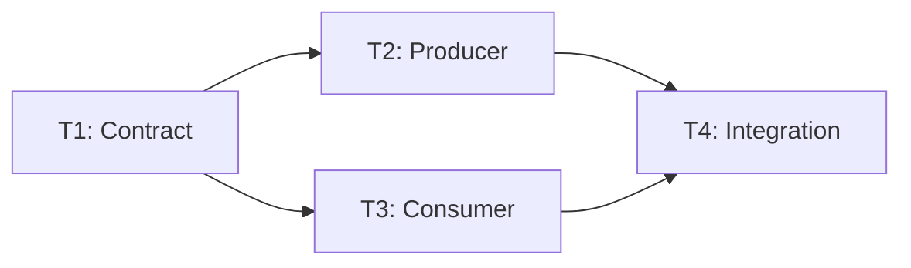
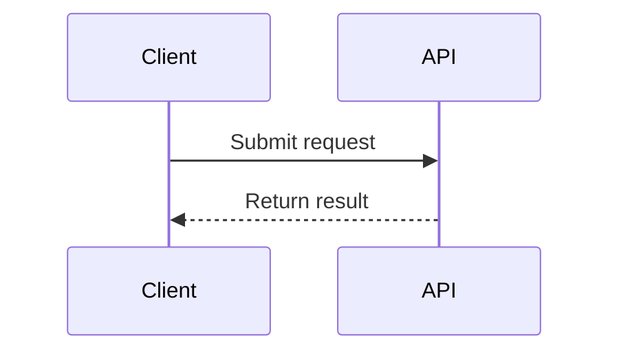
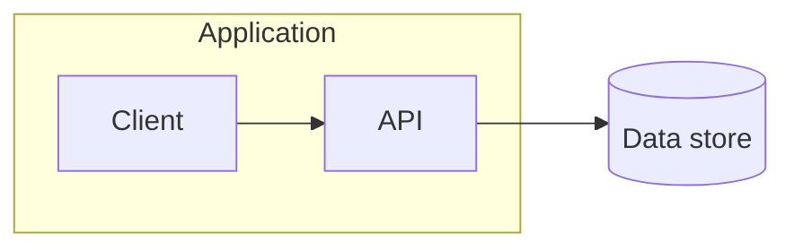
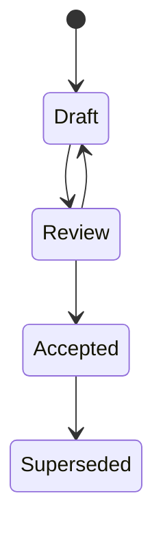
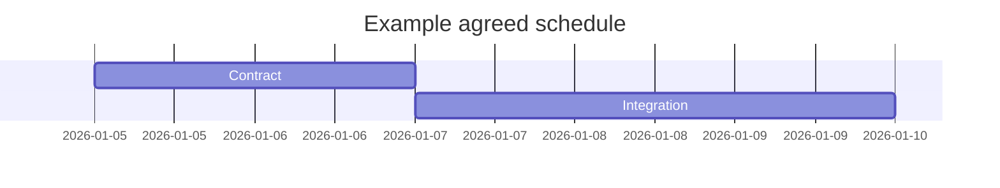

# Visualizations

Embed Mermaid in the relevant Markdown artifact when a diagram makes relationships clearer than prose or a table. Prefer GitHub-compatible, conservative syntax and short labels. Keep IDs and edges consistent with the task definitions, and update both when the plan changes. Avoid styling and renderer-specific features unless the project requires them. A separate diagram file is justified only by reuse or complexity; no external renderer is required.

Use flowcharts for processes and dependency graphs, sequence diagrams for interactions over time, flowcharts with subgraphs for architecture boundaries, and state diagrams for lifecycle transitions. Gantt charts are for actual scheduling, not merely a dependency order. The examples below are illustrative, not project facts.

## Dependency graph

An arrow points from prerequisite to dependent; the task table remains authoritative.

## Sequence

## Architecture boundaries

## Lifecycle

## Schedule

Use only with actual agreed dates and durations; this illustrative chart does not imply estimates for another plan.

A DAG communicates ordering, not duration, staffing, or calendar dates. Validate diagram syntax with an existing project renderer if available; otherwise inspect it and state that rendering was not verified.
